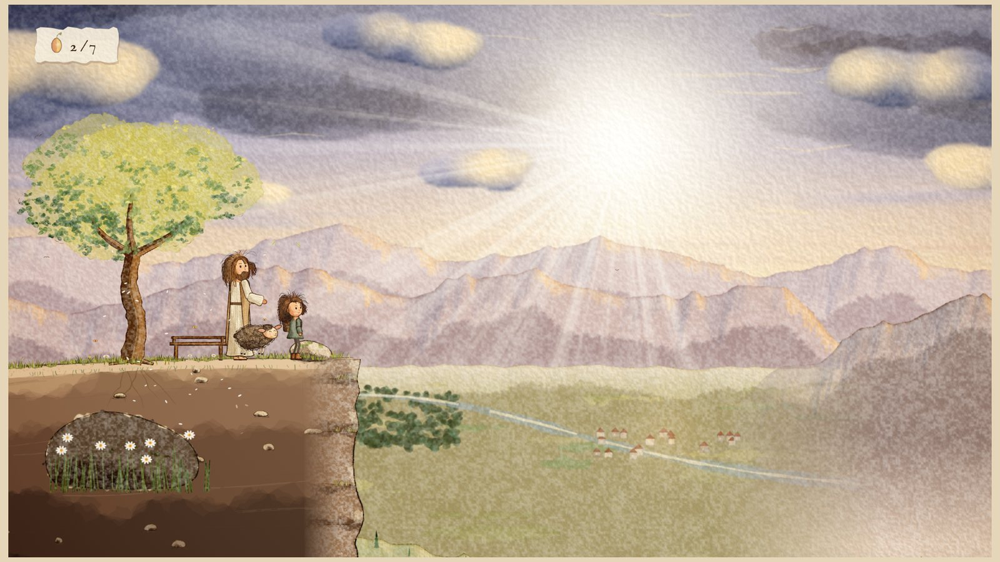

# Camino de montaña al amanecer



Primera prueba jugable (Biblia Visual §48) del videojuego 2D de desplazamiento lateral en acuarela:
la niña, la oveja y el Buen Pastor suben un sendero de montaña al amanecer hasta un mirador
desde el que se descubre el valle.

Todo el arte se pinta **en el navegador, por código**, imitando las técnicas de la lámina
conceptual: lavados de acuarela por capas, granulación que nace del relieve del papel,
bordes oscurecidos al secar, tinta sepia de grosor variable, pincel seco y papel de algodón.
No hay imágenes prefabricadas: cada pieza se pinta una vez al cargar y se anima con un
esqueleto, así cada cuadro conserva exactamente las mismas proporciones (§14).

## Cómo jugar

Abre `index.html` en cualquier navegador moderno (doble clic; no necesita servidor ni
instalación). También puedes generar un único archivo para compartir:

```bash
python3 tools/build_artifact.py
```

Eso crea `dist/camino-de-montana.html`, que funciona solo.

| Acción | Teclado | Mando | Táctil |
| --- | --- | --- | --- |
| Caminar | ← → o A D | stick / cruceta | ◀ ▶ |
| Correr | Mayús (o X) | X / gatillo | doble toque sostenido en ◀ ▶ |
| Saltar (mantener = más alto) | Espacio, Z o ↑ | A | ⤒ |
| Trepar | ↑ / ↓ junto a la escalera | cruceta | ↑ |
| Interactuar | E o Enter | B / Y | ✋ |
| Pausa | Esc o P | Start | Ⅱ |
| Hoja de personajes | H en el título o en la pausa | — | menú del título |

## Qué contiene la prueba

- **Recorrido completo** en seis tramos (§66): sendero con flores y cerca, rocas‑plataforma y
  una grieta, un olivo con ramas a las que subir, un puente de cuerdas que se hunde bajo el peso
  y al que le faltan tablas, una pared de piedra con escalera, una roca que hay que empujar hasta
  el escalón, un tronco caído sobre un barranco y el **mirador**.
- **La niña**: caminar, correr, saltar (anticipación, ascenso, ápice, caída, aterrizaje),
  trepar de espaldas, empujar, interactuar, acariciar a la oveja, mirar el paisaje, cansancio
  tras correr mucho; pelo con física que reacciona a la velocidad y al viento; parpadeo y
  miradas; siete expresiones sutiles.
- **La oveja** sigue el rastro de la niña, salta donde ella saltó, espera mirando hacia arriba
  cuando la niña sube a las ramas, cruza la pared por **su propia grieta** (§30), olfatea las
  semillas secretas cercanas, come, se duerme si la niña tarda y se alegra con las caricias.
- **El Buen Pastor** aparece en cuatro paradas, habla con calma, señala el camino y se
  desvanece en luz para esperar más adelante; nunca resuelve los obstáculos (§31).
- **Mirador** (§49–§50): la niña deja de correr y mira el valle, el viento le mueve el pelo, la
  oveja llega y se tumba, el pastor aparece detrás, la cámara se aleja y los rayos de sol
  atraviesan las nubes. Abajo se ven el río, un bosque y un pueblo con luces: presagios de los
  mundos siguientes.
- **Coleccionables sin monedas** (§28): siete semillas de luz (dos secretas) y una página del
  diario en un cofre.
- **Faroles** como puntos de control (§69) y caída sin violencia: desvanecerse en luz y volver
  al último farol (§70).
- **Parallax en seis planos** (§17): cielo, nubes que derivan, rayos, montañas lejanas, valle,
  colinas, plano jugable y primerísimo plano.
- **Cámara** que deja a la niña cerca del 40 % horizontal mirando hacia delante, suaviza todo
  y hace un alejamiento cinematográfico en el mirador (§16).
- **Interfaz de papel y tinta** (§34–§37): HUD mínimo, notas de diálogo, página del diario,
  menús de cuaderno y transiciones de pigmento que se expande.
- **Hoja de personajes** dentro del juego (Fases A/B de §47): animaciones en bucle de los tres
  personajes, expresiones (§74), tabla de escala (§72), paleta muestreada de la lámina (§6) y la
  lámina original al lado para comparar (§81).

## Estructura

```
index.html               página del juego (scripts clásicos: funciona con file://)
src/util.js              matemáticas, azar con semilla, ruido, color
src/palette.js           paleta muestreada de la lámina
src/textures.js          papel de algodón y campos de granulación
src/paint.js             kit de acuarela: lavados, tinta, pincel seco, salpicado, secado
src/art/props.js         rocas, hierba, flores, árboles, ramas
src/art/objects.js       madera, farol, cofre, semilla, página
src/art/scenery.js       cielo, nubes, rayos, montañas, valle, colinas y suelo del nivel
src/chars/rig.js         IK, ciclos de marcha, mechones con física
src/chars/girl.js        la niña
src/chars/sheep.js       la oveja
src/chars/shepherd.js    el Buen Pastor
src/world/level.js       datos del nivel «Camino de montaña al amanecer»
src/world/layers.js      capas de parallax troceadas
src/world/physics.js     control de plataformas, escalera, empujar, puente
src/world/camera.js      cámara
src/world/entities.js    oveja, pastor, semillas, faroles, cofre
src/world/ambient.js     hierba y flores que se mecen, mariposas, pájaros, partículas
src/input.js             teclado, mando y táctil
src/ui.js                HUD, diálogos, menús, transiciones
src/sheet.js             hoja de personajes
src/game.js              bucle, estados, cinemática, dibujo
docs/BIBLIA_VISUAL.md    la biblia visual (fuente de verdad)
docs/referencias/        lámina conceptual original
docs/VALIDACION_PRUEBA_1.md  validación de esta prueba contra la biblia (§45, §81, §83)
tools/build_artifact.py  empaquetado en un único HTML
tools/recorrido.js       prueba automática de recorrido completo
```

## Prueba automática

Con Node.js y Playwright (`npm install` instala la versión fijada en `package.json`):

```bash
npm test
```

Un bot juega el nivel completo y comprueba que se llega al final sin caídas, que el cofre da la
página del diario, que la oveja llega al mirador y que no hay errores en la página. Con
`node tools/recorrido.js --capturas carpeta/` guarda además capturas del título, el final y la
hoja de personajes.

## Estado

Esta es la **primera prueba** del pipeline (§47, §79). Siguiendo la regla de detención (§80), no
se han producido todavía los siete mundos: primero hay que validar esta escena. La evaluación
detallada, con capturas comparadas con la lámina y los puntos que aún no llegan al 9/10, está en
[`docs/VALIDACION_PRUEBA_1.md`](docs/VALIDACION_PRUEBA_1.md).
