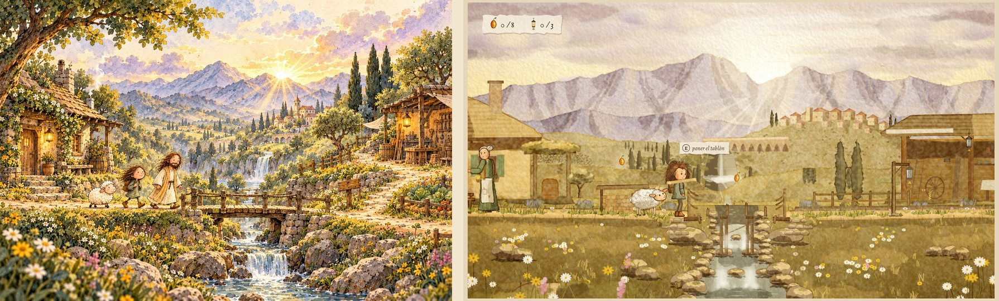
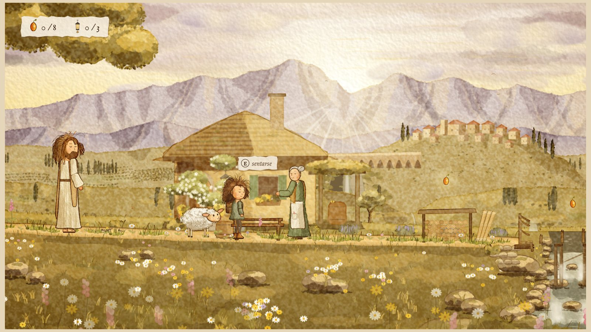
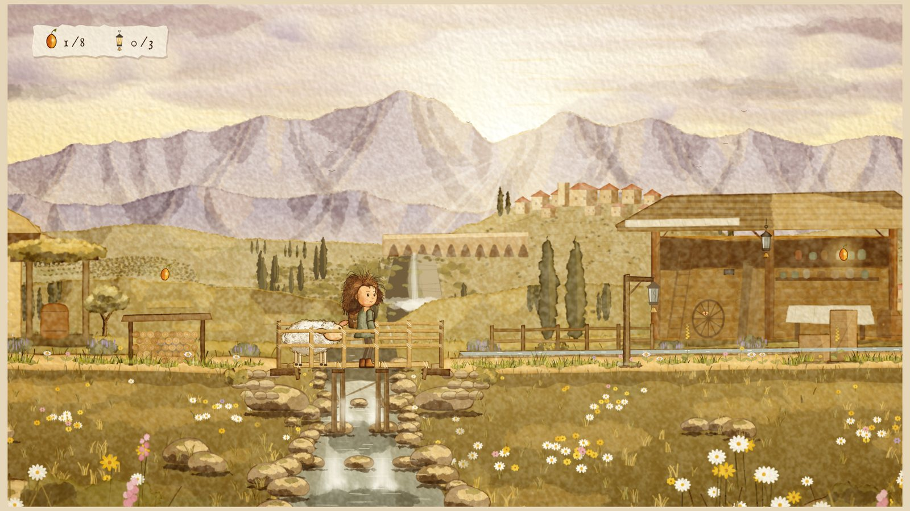
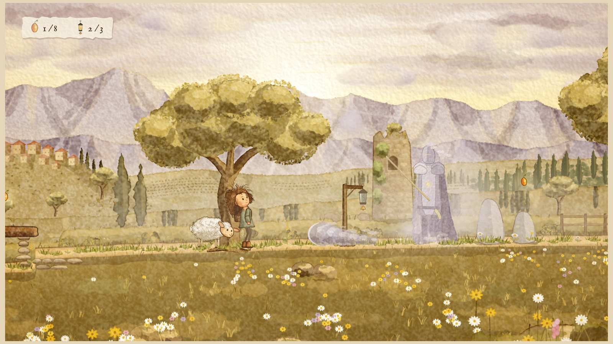

# Camino de montaña al amanecer


Primera prueba jugable (Biblia Visual §48) del videojuego 2D de desplazamiento lateral en acuarela:
la niña, la oveja y el Buen Pastor suben un sendero de montaña al amanecer hasta un mirador
desde el que se descubre el valle.

Todo el arte se pinta **en el navegador, por código**, imitando las técnicas de la lámina
conceptual: lavados de acuarela por capas, granulación que nace del relieve del papel,
bordes oscurecidos al secar, tinta sepia de grosor variable, pincel seco y papel de algodón.
No hay imágenes prefabricadas: cada pieza se pinta una vez al cargar y se anima con un
esqueleto, así cada cuadro conserva exactamente las mismas proporciones (§14).

## Cómo jugar

Abre `index.html` en cualquier navegador moderno (doble clic; no necesita servidor ni
instalación). También puedes generar un único archivo para compartir:

```bash
python3 tools/build_artifact.py
```

Eso crea `dist/camino-de-montana.html`, que funciona solo.

| Acción | Teclado | Mando | Táctil |
| --- | --- | --- | --- |
| Caminar | ← → o A D | stick / cruceta | ◀ ▶ |
| Correr | Mayús (o X) | X / gatillo | doble toque sostenido en ◀ ▶ |
| Saltar (mantener = más alto) | Espacio, Z o ↑ | A | ⤒ |
| Trepar | ↑ / ↓ junto a la escalera | cruceta | ↑ |
| Agacharse (mantener = la cámara mira abajo) | ↓ o S | cruceta abajo | ↓ |
| Interactuar: abrir, hablar, acariciar, recoger campanillas, sentarse, leer, sacudir árboles | E o Enter | B | ✋ |
| Llamar a la oveja | C o Q | Y | ♪ |
| Sonido sí / no | M | — | menú de pausa |
| Pausa | Esc o P | Start | Ⅱ |
| Hoja de personajes | H en el título o en la pausa | — | menú del título |

## Qué contiene la prueba

- **Recorrido completo** en seis tramos (§66): sendero con flores y cerca, rocas‑plataforma y
  una grieta, un olivo con ramas a las que subir, un puente de cuerdas que se hunde bajo el peso
  y al que le faltan tablas, una pared de piedra con escalera, una roca que hay que empujar hasta
  el escalón, un tronco caído sobre un barranco y el **mirador**.
- **La niña**: caminar, correr, saltar (anticipación, ascenso, ápice, caída, aterrizaje),
  trepar de espaldas, empujar, interactuar, acariciar a la oveja, mirar el paisaje, cansancio
  tras correr mucho; pelo con física que reacciona a la velocidad y al viento; parpadeo y
  miradas; siete expresiones sutiles.
- **La oveja** sigue el rastro de la niña, salta donde ella saltó, espera mirando hacia arriba
  cuando la niña sube a las ramas, cruza la pared por **su propia grieta** (§30), olfatea las
  semillas secretas cercanas, come, se duerme si la niña tarda y se alegra con las caricias.
- **El Buen Pastor** aparece en cuatro paradas, habla con calma, señala el camino y se
  desvanece en luz para esperar más adelante; nunca resuelve los obstáculos (§31).
- **Mirador** (§49–§50): la niña deja de correr y mira el valle, el viento le mueve el pelo, la
  oveja llega y se tumba, el pastor aparece detrás, la cámara se aleja y los rayos de sol
  atraviesan las nubes. Abajo se ven el río, un bosque y un pueblo con luces: presagios de los
  mundos siguientes.
- **Coleccionables sin monedas** (§28): ocho semillas de luz (tres secretas: una solo cae si se
  sacude su árbol), una página del diario en un cofre y cinco campanillas que la niña puede
  recoger y regalar al Pastor en el mirador.
- **Faroles** como puntos de control (§69) y caída sin violencia: desvanecerse en luz y volver
  al último farol (§70).
- **Parallax en seis planos** (§17): cielo, nubes que derivan, rayos, montañas lejanas, valle,
  colinas, plano jugable y primerísimo plano.
- **Cámara** que deja a la niña cerca del 40 % horizontal mirando hacia delante, suaviza todo
  y hace un alejamiento cinematográfico en el mirador (§16).
- **Interfaz de papel y tinta** (§34–§37): HUD mínimo, notas de diálogo, página del diario,
  menús de cuaderno y transiciones de pigmento que se expande.
- **Hoja de personajes** dentro del juego (Fases A/B de §47): animaciones en bucle de los tres
  personajes, expresiones (§74), tabla de escala (§72), paleta muestreada de la lámina (§6) y la
  lámina original al lado para comparar (§81).

## Segunda pasada: más animación, interactividad y detalle

Tras revisar la primera versión se corrigieron los fallos visibles (al desvanecerse el Pastor ya no
quedan mechones flotando: cada personaje se funde entero; la roca que se empuja es ahora una piedra
facetada que se ve bien desde cualquier ángulo) y se añadió:

- **Animación de la niña:** giro con transición, frenada al soltar la carrera, equilibrio con los
  brazos en molinete al borde de un precipicio, agacharse, mirar arriba, secuencia de espera
  (se estira, mira al cielo, se sienta en el suelo), sentarse en los bancos, encaramarse al final
  de la escalera, mochila y bajo del suéter con inercia, la cabeza que sigue lo que le interesa
  (el Pastor, una semilla, la oveja, una mariposa), huellas en el sendero y vaho al respirar.
- **La oveja** mueve la cola, bala con un bocadillo de papel, acude deprisa cuando la llamas, se
  alegra al reencontrarse con la niña y sigue con la mirada a las mariposas.
- **El Pastor** saluda al verla llegar, se inclina para hablarle, la túnica se mueve con el viento
  y, si le llevas campanillas, las recibe en el mirador y las sostiene durante la bendición.
- **Mundo interactivo:** pajarillos que echan a volar al acercarte, mariposas que huyen y que se
  posan en el pelo de la niña si se sienta un rato, hierba y flores que se apartan al pasar,
  árboles que se sacuden (caen hojas y una semilla escondida), un letrero que se puede leer y
  faroles que se encienden con un anillo de luz.
- **Detalle pintado y animado:** una cascada en el desfiladero, la pared de roca en estratos, la
  grieta con raíces y piedras encajadas, humo en las chimeneas del pueblo y ventanas que titilan,
  sombras de nubes sobre las colinas, polillas en los faroles, destellos de rocío y polen en los
  rayos de sol. El grano del papel es ahora isótropo (antes dejaba un mosaico cuadrado en los
  pigmentos densos).
- **Sonido sintetizado** (sin archivos): viento, pájaros, pasos según la superficie, el puente
  que cruje, balidos, campanillas de luz y una música mínima de arpa. Empieza con la primera
  tecla; M o el menú de pausa lo silencian.
- **Hoja de personajes:** nueva página con todas las animaciones añadidas.

## Mundo 1: «Valle del Amanecer»

Al terminar el prólogo, el menú final ofrece **bajar al Valle del Amanecer** (también se elige desde
el título, o con `index.html?mundo=m01`). Sigue la [ficha de mundo](docs/mundos/M01_Ficha_de_Mundo.md)
y el [arte conceptual](docs/referencias/M01_concepto_valle_del_amanecer.jpg); las decisiones de
adaptación están en [`docs/mundos/M01_Diseno.md`](docs/mundos/M01_Diseno.md).



- **El lugar:** la casa de piedra de Ester con su farol encendido, el gran árbol que enmarca el cielo,
  un puente de tablas sobre el arroyo que baja en saltos entre rocas, el taller, la huerta con su
  acequia, el pueblo del campanario con su acueducto y su cascada, olivos y cipreses, montañas lavanda
  y la luz de miel de un sol bajo.
- **Remendar el puente:** tres tablones de la leñera, de uno en uno (con carga no se corre ni se salta).
- **Tres estaciones de ruta** (farol de vidrio y campana) que se reparan manteniendo E. Con cada una
  el valle cambia: el taller se abre, la ropa se tiende, el agua llega a los campos, la huerta crece,
  el pueblo enciende sus ventanas y toca la campana. La geometría de colisión no cambia.
- **Ester**, la vecina: saluda, riega, mira la colina y se estira; lo que cuenta cambia con el valle.
- **El Caballero de la Niebla** en la Colina de las Piedras: anuncia cada ola con la lanza, el cuerno y
  la niebla que se junta en la punta; las bajas se saltan y las altas se pasan agachada. Si alcanzan a
  la niña, solo la empujan. Al lucir el último farol se arrodilla y la niebla se retira.
- **Opciones de comodidad** en la pausa: «Primer plano: reducido» y «Niebla: reducida».
- **Final:** la cámara recorre el valle restaurado y el Pastor bendice el camino hacia el bosque.

| Casa de Ester | Puente remendado | El Caballero |
| --- | --- | --- |
|  |  |  |

## Estructura

```
index.html               página del juego (scripts clásicos: funciona con file://)
src/util.js              matemáticas, azar con semilla, ruido, color
src/palette.js           paleta muestreada de la lámina
src/textures.js          papel de algodón y campos de granulación
src/paint.js             kit de acuarela: lavados, tinta, pincel seco, salpicado, secado
src/art/props.js         rocas, hierba, flores, árboles, ramas
src/art/objects.js       madera, farol, cofre, semilla, página
src/art/scenery.js       cielo, nubes, rayos, montañas, valle, colinas y suelo del nivel
src/chars/rig.js         IK, ciclos de marcha, mechones con física
src/chars/girl.js        la niña
src/chars/sheep.js       la oveja
src/chars/shepherd.js    el Buen Pastor
src/chars/ester.js       Ester (Mundo 1)
src/chars/knight.js      el Caballero de la Niebla y sus olas (Mundo 1)
src/worlds/m00.js        guion del prólogo
src/worlds/m01/          Mundo 1: nivel, arte por capas y guion (estados, estaciones, encuentro, final)
src/world/level.js       datos del prólogo «Camino de montaña al amanecer»
src/world/layers.js      capas de parallax troceadas
src/world/physics.js     control de plataformas, escalera, empujar, puente
src/world/camera.js      cámara
src/world/entities.js    oveja, pastor, semillas, faroles, cofre
src/world/ambient.js     hierba y flores que se mecen, mariposas, pájaros, partículas
src/world/life.js        cascada, humo y ventanas del pueblo, sombras de nubes, polillas, rocío
src/sound.js             sonido sintetizado con WebAudio
src/input.js             teclado, mando y táctil
src/ui.js                HUD, diálogos, menús, transiciones
src/sheet.js             hoja de personajes
src/game.js              bucle, estados, cinemática, dibujo
docs/BIBLIA_VISUAL.md    la biblia visual (fuente de verdad)
docs/referencias/        lámina conceptual original
docs/VALIDACION_PRUEBA_1.md  validación de esta prueba contra la biblia (§45, §81, §83)
tools/build_artifact.py  empaquetado en un único HTML
tools/recorrido.js       prueba automática del prólogo
tools/recorrido_m01.js   prueba automática del Mundo 1
docs/mundos/             ficha y diseño del Mundo 1
```

## Prueba automática

Con Node.js y Playwright (`npm install` instala la versión fijada en `package.json`):

```bash
npm test
```

Primero el prólogo y después el Mundo 1. En el prólogo, un bot juega el nivel completo (con paso de tiempo fijo, para que el resultado no dependa de la
velocidad del equipo) y comprueba que se llega al final sin caídas, que el cofre da la página del
diario, que recoge campanillas y sacude el árbol de la semilla escondida, que la niña regala el
ramillete al Pastor en el mirador, que la oveja llega con ella y que no hay errores en la página. Con
`node tools/recorrido.js --capturas carpeta/` guarda además capturas del título, el final y la
hoja de personajes. En el Mundo 1, otro bot habla con Ester, remienda el puente, repara las tres
estaciones, abre el cofre, esquiva las olas del Caballero y llega al final sin caerse.

## Estado

Esta es la **primera prueba** del pipeline (§47, §79). Siguiendo la regla de detención (§80), no
se han producido todavía los siete mundos: primero hay que validar esta escena. La evaluación
detallada, con capturas comparadas con la lámina y los puntos que aún no llegan al 9/10, está en
[`docs/VALIDACION_PRUEBA_1.md`](docs/VALIDACION_PRUEBA_1.md).
