# Validación — Primera prueba obligatoria (§48)

**Escena:** Camino de montaña al amanecer · **Fase del pipeline:** D (validación, §47)
**Cómo se generó:** todo el arte se pinta por código en el navegador (lavados de acuarela por
capas, granulación ligada al relieve del papel, bordes oscurecidos al secar, tinta sepia de grosor
variable, pincel seco). Las capturas de esta carpeta salen del propio juego en Chromium a 1920×1080.

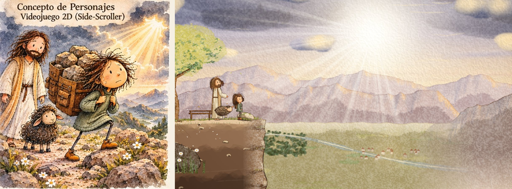

## Resultado en una línea

La escena es jugable de principio a fin y se reconoce el universo de la lámina: los tres
personajes, la paleta, la luz de amanecer entre nubes de tormenta y el papel. **Todavía no alcanza
el 9/10 que exige §83**: comparado con la lámina, el juego tiene menos tinta, menos detalle y
colores más pálidos, y el pelo de la niña tiene menos volumen. Por la regla de detención (§80)
no se han producido aún los siete mundos; la lista de correcciones para la segunda pasada está al
final.

## Autoevaluación por asset (§83)

Puntuaciones honestas sobre 10. Umbral de aprobación: 9 en personaje y en estilo.

| Asset | Personaje | Estilo | Color | Textura | Coherencia | Estado |
| --- | --- | --- | --- | --- | --- | --- |
| Niña | 7 | 7 | 8 | 7 | 7 | Corregir pelo y rostro |
| Oveja | 8 | 7,5 | 8,5 | 7,5 | 8 | Cerca: falta relieve en los rizos |
| Buen Pastor | 7 | 7 | 8 | 7 | 7 | Corregir melena y manto |
| Cielo y montañas | — | 7,5 | 8 | 7 | 7,5 | Más pigmento cerca del sol |
| Sendero, rocas, madera | — | 7 | 7,5 | 7 | 7 | Más tinta y detalle en las rocas |
| Interfaz (papel y tinta) | — | 8 | 8,5 | 8 | 8 | Aprobable tras la segunda pasada |

### Qué sí está conseguido

- **Niña:** cabeza grande sin ser chibi, cuerpo y piernas finas, ojos negros pequeños, nariz
  pequeña, boca mínima, mejillas rosadas; suéter‑vestido verde grisáceo con punto elástico, medias
  oscuras, botines anaranjados con cordones y mochila de cuero con hebilla. Todos los cuadros usan
  las mismas piezas pintadas y el mismo esqueleto, así que no hay deriva entre cuadros (§14).
- **Oveja:** lana oscura rizada con motas claras, cabeza beige, ojos pequeños, orejas laterales
  con interior rosado, patas delgadas con pezuña oscura y sonrisa amable.
- **Pastor:** cabello largo castaño, barba, rostro amable, túnica clara con costuras punteadas,
  manto beige, cinturón de cuerda y sandalias; movimiento pausado.
- **Paleta:** las 14 manchas del recuadro «Paleta de Color (Estilo)» se muestrearon de la lámina
  y gobiernan todo el juego (página 2 de la hoja de personajes).
- **Luz narrativa (§7):** amanecer dorado que se abre en un cielo de tormenta, rayos pintados con
  estrías de pincel seco (no haces digitales), faroles cálidos.
- **Sin deriva prohibida (§4):** nada de pixel art, 3D, anime, vector ni brillo plástico. El grano
  no es un filtro sobre el fotograma: cada pieza se pinta con lavados y luego se «seca» en espacio
  de pigmento, de modo que el grano y el borde oscuro solo aparecen donde hay pigmento.
- **Sin elementos de Nintendo (§1):** no hay bloques, tuberías, monedas ni enemigos equivalentes;
  los coleccionables son semillas de luz y una página del diario.

### Dónde no llega todavía (y por qué)

1. **Pelo de la niña.** En la lámina es una masa enorme de rizos marrón oscuro con reflejos
   rojizos y muchos trazos de tinta negra. En el juego es más pequeño y de mechones más rectos.
2. **Trazo.** La lámina tiene una línea sepia nerviosa, repasada, con sombreado a plumilla en
   rocas y ropa. La línea del juego es orgánica pero más limpia y regular, sin plumilla.
3. **Detalle del entorno.** Las rocas de la portada están cargadas de pigmento, motas y tinta; las
   del juego son más planas. El corte de tierra del plano jugable es una convención de juego que
   no aparece en la lámina y resta parecido.
4. **Saturación y contraste.** La lámina tiene naranjas cálidos intensos junto al sol y azules
   tormenta profundos. El juego es más pastel, sobre todo en las montañas lejanas.
5. **Pastor.** En miniatura, la masa de pelo de detrás se lee un poco como una capucha; en la
   lámina la melena cae a ambos lados de la cara, con raya al medio, y el manto cubre los dos hombros.

## Lista de control visual (§45)

| Pregunta | Respuesta |
| --- | --- |
| ¿Parece el mismo personaje? | Sí, se reconocen; diferencias de volumen en el pelo |
| ¿Mantiene la paleta? | Sí, muestreada de la lámina |
| ¿Mantiene el trazo? | En parte: tinta sepia orgánica, más limpia que la lámina |
| ¿Mantiene la técnica? | Sí: acuarela y tinta simuladas desde el origen |
| ¿Parece acuarela? | Sí: lavados por capas, bordes oscurecidos, granulación |
| ¿Mantiene textura? | Sí, papel ligero que no estorba al juego |
| ¿Es legible? | Sí: contornos en personajes, bordes entintados en plataformas, brillo en objetos |
| ¿Encaja con las referencias? | En parte |
| ¿Hay deriva hacia otro estilo? | No hacia los prohibidos; algo hacia una acuarela digital limpia en los fondos |
| ¿Podría formar parte del mismo libro? | Cerca, todavía no |

## Requisitos de la prueba (§48–§50)

| Requisito | Estado | Dónde |
| --- | --- | --- |
| Niña, oveja y pastor | ✔ | todo el nivel |
| Rocas, flores, árboles, senderos | ✔ | todo el nivel |
| Montañas, nubes, rayos de sol | ✔ | capas de fondo |
| Parallax por capas | ✔ | cielo, nubes, montañas lejanas, valle, colinas, juego, primer plano |
| Plataformas naturales | ✔ | rocas, ramas, puente, escalón de piedra, tronco caído |
| La cámara sigue con suavidad y se adelanta | ✔ | la niña queda cerca del 40 % horizontal |
| Alejamiento en el mirador | ✔ | zoom de 1,12 a 0,7 en 6,5 s |
| La niña deja de correr, respira y observa el valle | ✔ | camina hasta el borde, respiración lenta, mirada |
| El pelo se mueve con el viento | ✔ | viento creciente en la cinemática |
| La oveja llega | ✔ | se alegra y se tumba a su lado |
| El pastor aparece al fondo | ✔ | aparece en luz detrás de ellas |
| Rayos de sol atraviesan las nubes | ✔ | los rayos se intensifican y las nubes se apartan |

## Capturas

| | |
| --- | --- |
| 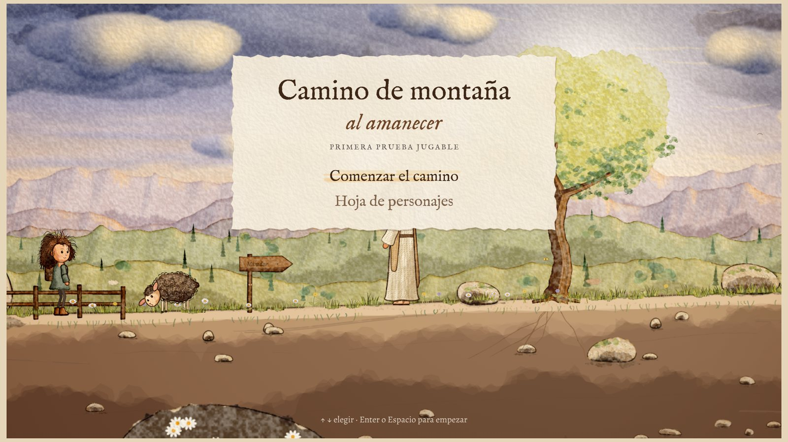 | 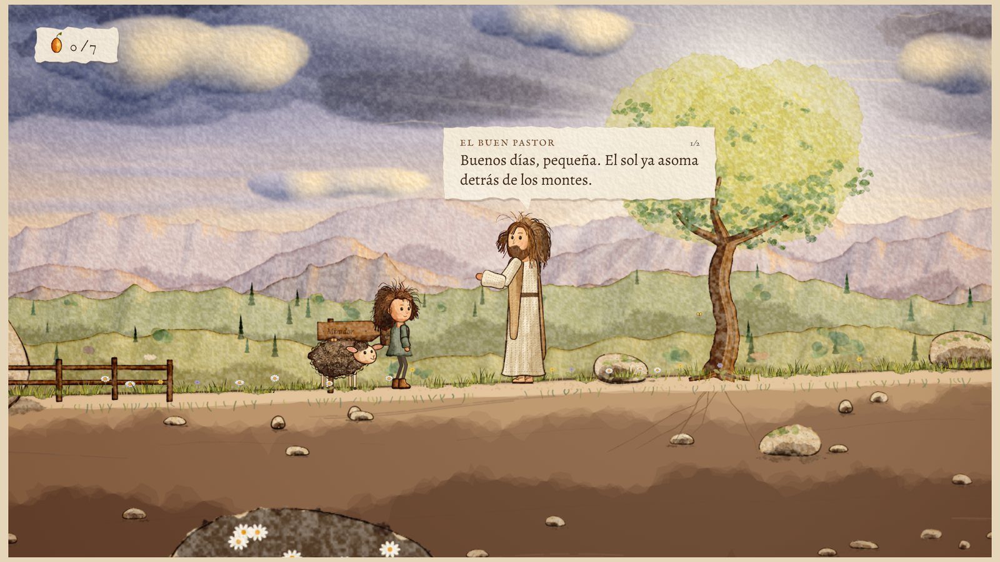 |
| 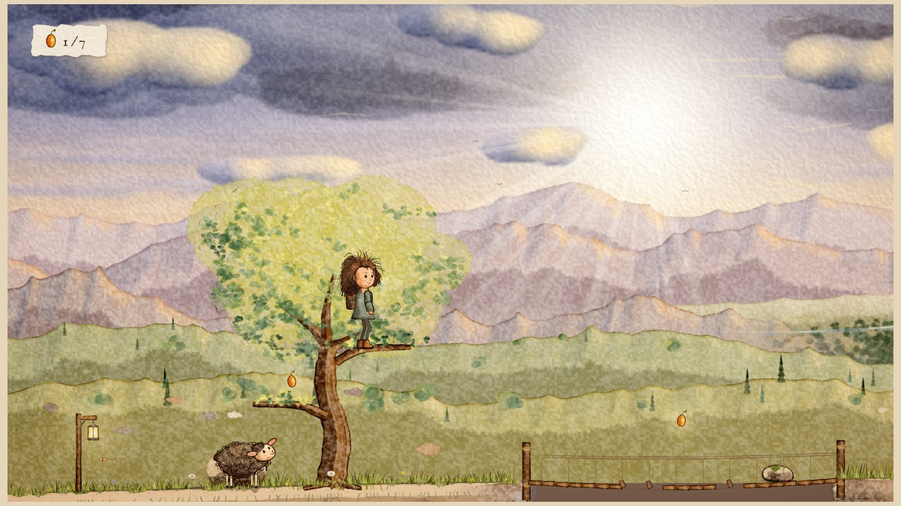 | 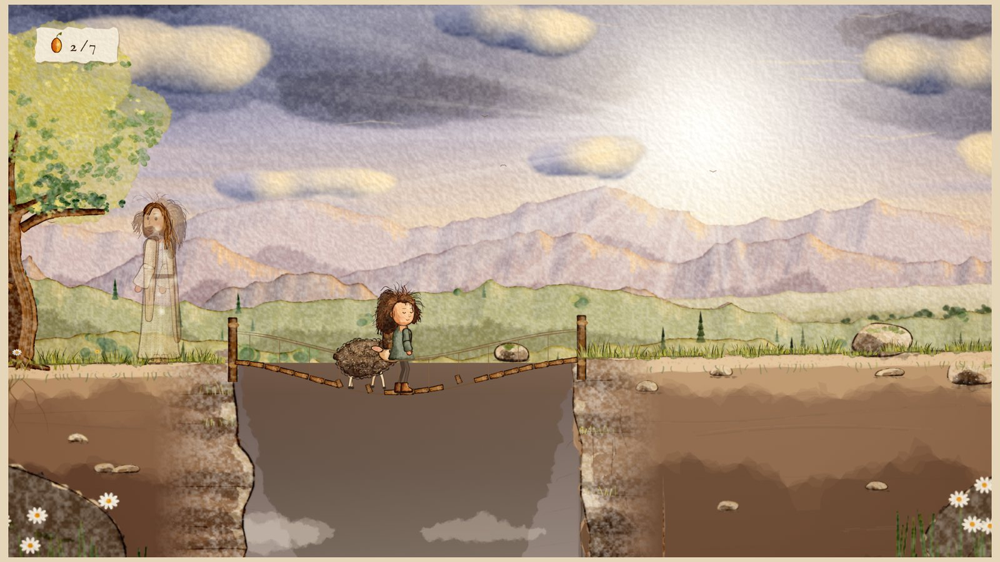 |
| 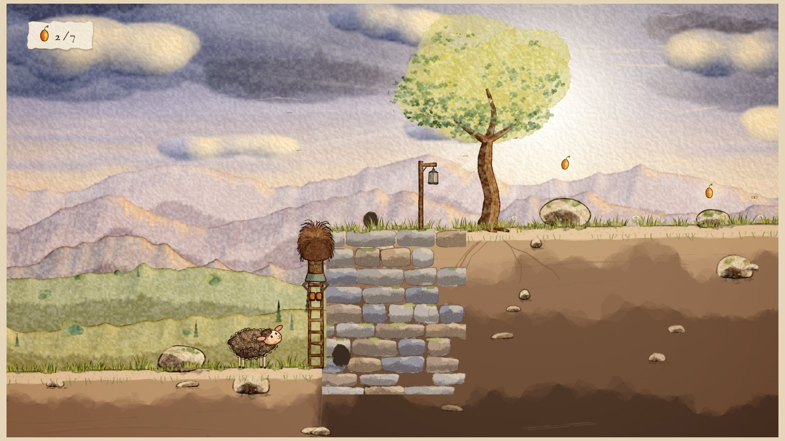 | 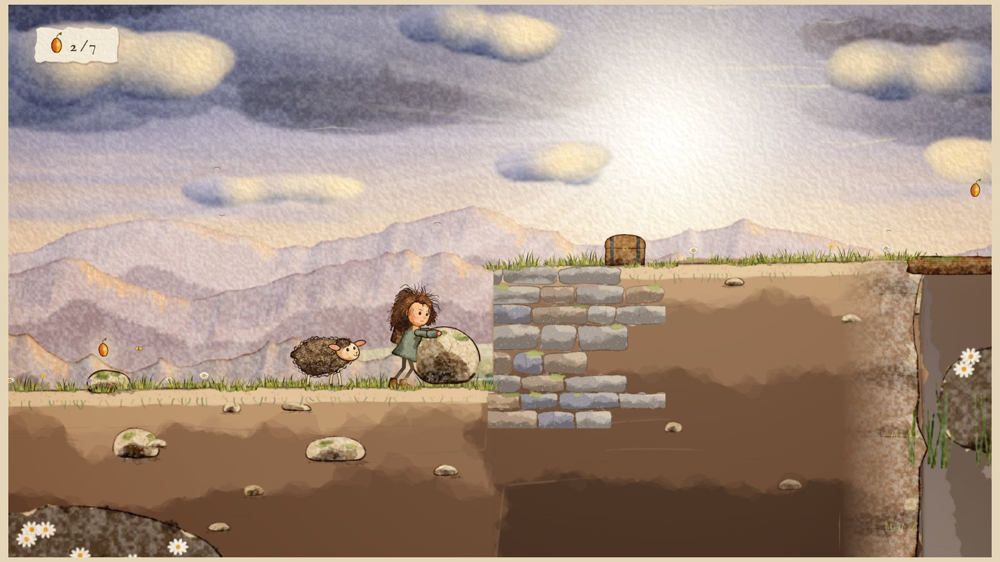 |
|  | 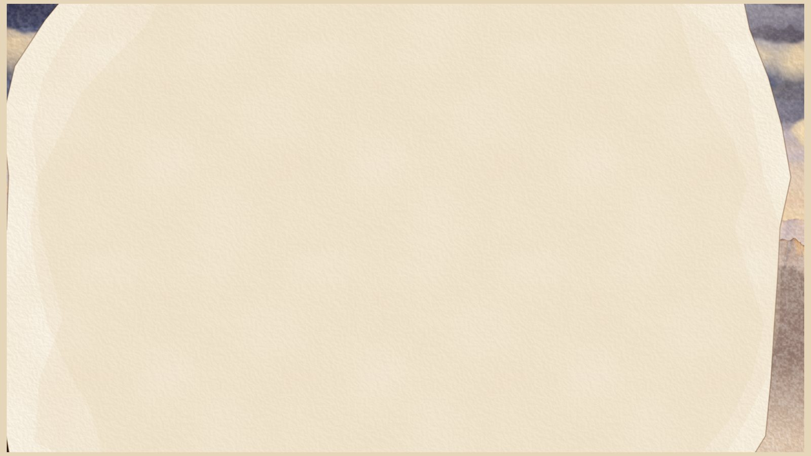 |
| 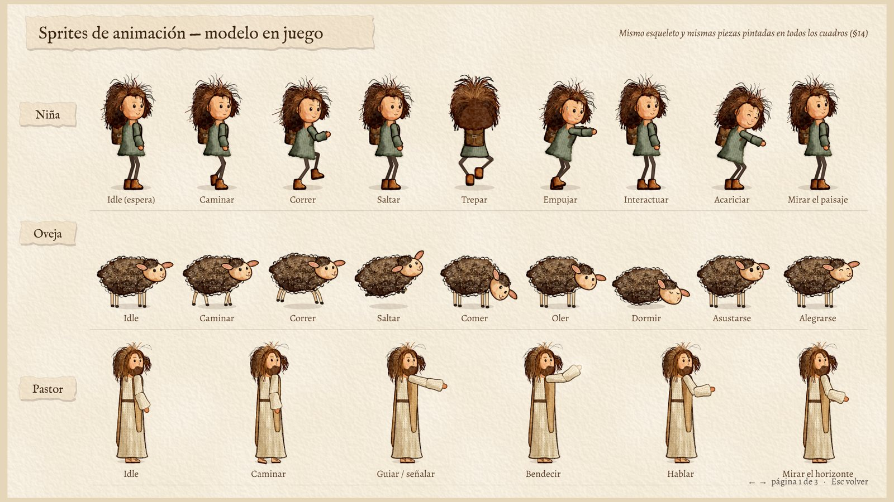 | 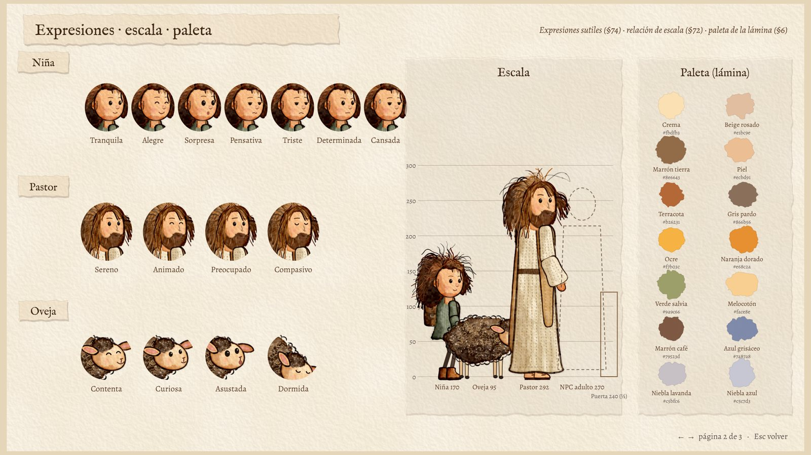 |

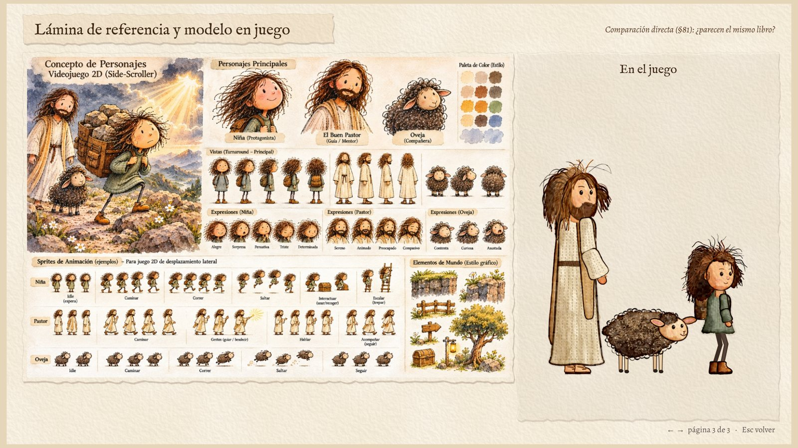

## Pruebas técnicas

- **Recorrido automático** (`npm test`, o `node tools/recorrido.js`): un bot juega el nivel
  completo dentro del bucle del juego. Resultado de la última ejecución: llega a la pantalla final
  en 49,8 s de juego, sin caídas, con la página del diario, 5 de 7 semillas (las dos secretas
  quedan fuera de su ruta), la oveja en el mirador y sin errores en la página.
- **Carga:** 5,3 s en Chromium sin ventana (render por software); 86 MB de lienzos de capas.
- **Móvil:** probado en un teléfono emulado de 844×390 en horizontal (controles táctiles) y en
  vertical (pide girar el teléfono).
- **No probado:** rendimiento con GPU real ni navegadores Safari o Firefox. En Chromium sin GPU la
  escena rinde entre 24 y 29 cuadros por segundo con seis actualizaciones por cuadro.

## Segunda pasada propuesta (antes de la Fase E)

1. Rehacer el pelo de la niña con rizos en espiral superpuestos, más volumen hacia los lados y
   reflejos rojizos; añadir trazos de tinta negra en los rizos exteriores.
2. Añadir a la tinta una segunda línea repasada y sombreado a plumilla en las sombras de rocas,
   ropa y madera.
3. Poblar el borde del sendero con rocas grandes entintadas y matas de margaritas, como la
   portada, y reducir la altura visible del corte de tierra.
4. Pastor: melena con raya al medio que cae a ambos lados, manto sobre los dos hombros.
5. Más pigmento naranja alrededor del sol y azul tormenta más profundo en el tercio superior.
6. Si el equipo cuenta con ilustrador: el esqueleto acepta piezas pintadas a mano (cada pieza es un
   sprite con su punto de anclaje), así que se pueden sustituir sin tocar la animación.
